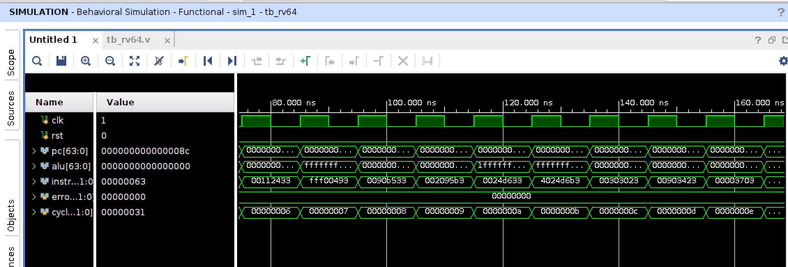

# 64-bit Single-Cycle RISC-V Processor — Design Report

**PBL-2 · FPGA and SoC Design (CO4) · B.Tech ECE, Semester VII**

---

## 1. What was built

The brief asks for a 64-bit processor with an ALU, register file, PC, instruction and data memories and a control unit, supporting arithmetic, logical, load, store and branch instructions, plus "AI for design parameter analysis such as delay, power and speed".

Rather than invent an instruction set, the processor implements a **subset of RV64I**, the 64-bit base integer ISA of RISC-V. Every category in the brief maps onto real RV64I instructions, the encodings are standard (so any RISC-V assembler or disassembler can check the test program), and the same datapath is the starting point for the 5-stage pipelined core planned next (section 7). The design is **single-cycle**: every instruction completes in one clock, CPI = 1.

| Task | Block | File |
|---|---|---|
| 1 — 64-bit ALU | 10 operations: add, sub, and, or, xor, slt, sltu, sll, srl, sra | `rtl/alu_64.v` |
| 2 — register file | 32 × 64, two asynchronous read ports, one synchronous write port, `x0` hard-wired to 0 | `rtl/regfile_64.v` |
| 3 — PC and instruction fetch | PC register, next-PC select (PC+4 / PC+imm / rs1+imm), 256 × 32 instruction memory | `rtl/pc_unit.v`, `rtl/imem.v` |
| 4 — control unit | main decoder on opcode, ALU decoder on funct3/funct7; immediate generator; branch comparator | `rtl/control.v`, `rtl/imm_gen.v`, `rtl/branch_unit.v` |
| 5 — integration | complete datapath with 256 × 64 data memory and writeback mux | `rtl/rv64_top.v`, `rtl/dmem.v` |
| 6 — testbench | self-checking, 36-instruction program, 31 checks | `tb/tb_rv64.v`, `sw/assemble.py` |
| 7 — AI analysis | Vivado design-space sweep (18 implemented runs) + ML surrogate models for Fmax, power and area | `sweep.tcl`, `analyze.py` |

**Supported instructions (30):** `add sub and or xor slt sltu sll srl sra` · `addi slti sltiu andi ori xori slli srli srai` · `ld sd` · `beq bne blt bge bltu bgeu` · `jal jalr` · `lui`.

The AI part answers three questions about the implemented design, each with its own mechanism:

| Question | Mechanism |
|---|---|
| *How fast can it run?* | Random-forest / gradient-boosting regressors trained on 18 Vivado runs predict achieved Fmax for any clock target and synthesis directive, including targets never run |
| *What does speed cost in power?* | A physics-informed model P = P<sub>static</sub> + k·f fitted per directive, alongside an ML power predictor |
| *Which design knob actually matters?* | Permutation importance over the trained models |

---

## 2. Architecture

```
   next PC  ◀── PC+4 | PC+imm (branch taken, jal) | (rs1+imm)&~1 (jalr)
      │
 ┌────┴────┐ pc  ┌──────────┐ instr ┌───────────┐
 │ pc_unit │────▶│  imem    │──┬───▶│  control  │──▶ reg_write  alu_src  mem_read
 └─────────┘     │ 256 × 32 │  │    └───────────┘    mem_write  wb_sel   branch
                 └──────────┘  │                     jump  jalr  alu_ctrl[3:0]
                               │
                               │ rs1,rs2,rd  ┌────────────┐ rd1 ──────────────▶┌────────┐
                               ├────────────▶│ regfile_64 │                    │ alu_64 │
                               │             │   32 × 64  │ rd2 ─┬─▶[alu_src]─▶│        │
                               │             └────────────┘      │      ▲      └───┬────┘
                               │                   ▲             │      │          │ result
                               └──▶ imm_gen ───────┼─────────────┼──────┘          │ = address
                                     (sign-ext)    │             │            ┌────▼─────┐
                                                   │             └─ store ───▶│  dmem    │
                                                   │                data      │ 256 × 64 │
                                                   │                          └────┬─────┘
                                                   └──── wb_sel: ALU | MEM | PC+4 | imm
```

**ALU (`alu_64.v`).** Purely combinational. Shifts use `b[5:0]`, the full 6-bit shift amount RV64 requires, so `slli x22, x1, 40` moves data across the 32-bit boundary. That is the instruction in the test program which proves the datapath is really 64 bits wide rather than 32 bits zero-extended. `slt` and `sra` use `$signed`; everything else is unsigned.

**Register file (`regfile_64.v`).** Two read ports, combinational, and one write port on the clock edge. Reads of `x0` return zero by a mux on the address rather than by keeping register 0 at zero, so a write to `x0` is harmless. Because `x0` is never written, synthesis removes its 64 flip-flops entirely (section 5.5).

**Immediate generator (`imm_gen.v`).** The brief's "sign extend" block. It builds the I, S, B, U and J formats from the instruction bits and sign-extends each to 64 bits from `instr[31]`. B and J immediates are scrambled in the encoding and come out with bit 0 forced to zero.

**Control (`control.v`).** Two levels, as in Patterson & Hennessy. The main decoder turns the 7-bit opcode into datapath controls and a 2-bit `alu_op`. The ALU decoder combines `alu_op` with `funct3` and `instr[30]` to choose the operation. `instr[30]` separates `add` from `sub` only for R-type: in I-type `addi` that bit is part of the immediate, and treating it as `sub` is a classic single-cycle bug.

**Branch unit (`branch_unit.v`).** A separate comparator on `rd1`/`rd2` for all six conditions, so a branch never needs the ALU's zero flag. The ALU stays free to compute the branch target, and `blt`/`bge`/`bltu`/`bgeu` need no extra ALU modes.

**PC unit (`pc_unit.v`).** The next PC is one of PC+4, PC+imm (taken branch or `jal`), or `(rs1+imm) & ~1` (`jalr`, low bit cleared as the spec requires). `jal`/`jalr` write PC+4 to `rd` through the writeback mux, which gives call and return.

**Memories (`imem.v`, `dmem.v`).** The instruction memory is 256 × 32, loaded from `program.hex` with `$readmemh`. It also has a write port, used as a program loader; the reason is in section 3(a). The data memory is 256 × 64, doubleword-addressed (`addr[10:3]`), with a synchronous write and an asynchronous read. Both read in the same cycle as their address, which the single-cycle design requires and which has a direct cost in section 5.5.

---

## 3. Four things worth knowing for the viva

None of these is visible in the block diagram, and each one changes how a number in section 5 should be read.

**(a) The instruction memory needs a write port, or synthesis measures the program instead of the processor.** With `$readmemh` and no write port, the instruction memory is a constant ROM. Vivado propagates those constants into the decoder and the datapath and removes every path the 36-instruction test program never uses: `bgeu` never executes, so its comparator disappears. The area, power and timing would then describe one program rather than the CPU. The program-loader port (`imem_we/waddr/wdata`, tied off in the testbench) makes the contents unknown at synthesis time, so the logic for all 30 instructions is kept. This was caught before the sweep, not measured afterwards, so there is no before/after figure for it.

**(b) Fmax measured at a relaxed constraint is not the ceiling.** At a 20 ns or 25 ns target the design meets timing with a minimum period of about 19.6 ns (≈ 51 MHz). Asked for 10 ns, Vivado works harder and gets the same design down to 15.88 ns (63.0 MHz), even though the run "fails". The tool stops optimising once a constraint is met, so the Fmax worked out from a passing run is a lower bound. The real ceiling comes from the over-constrained runs, which is why the sweep deliberately includes targets the design cannot meet (section 5.2).

**(c) One synthesis directive did nothing, and the "area" directive was the fastest.** `PerformanceOptimized` produced results identical to `Default` at 5 of 6 clock targets: the same netlist, slack and power. `AreaOptimized_high` was best on all three axes at once: fewest LUTs, lowest power and highest Fmax. That sounds backwards until you see that 74–84 % of every critical path is routing (section 5.3). In a route-dominated design, less logic means shorter wires, so the area directive wins on speed as well.

**(d) Icarus reports 50 cycles and XSim reports 49 for the same program.** The testbench polls for the halt instruction in a `while` loop clocked on `posedge clk`. The two simulators order that read against the PC update differently by one delta cycle, so the counter differs by one. Every register and memory value is identical in both runs, and every check is made after the halt, so the result does not depend on that ordering.

---

## 4. Verification (Task 6)

`tb/tb_rv64.v` is self-checking. It loads `program.hex`, releases reset, runs until the PC reaches the halt instruction (`beq x0, x0, 0`), then compares the register file and data memory against expected values and prints PASS/FAIL for each. It also prints a per-cycle trace (PC, instruction, ALU result) and dumps `rv64.vcd`.

The test program is written with `sw/assemble.py`, a small RV64I encoder, so the hex is generated rather than hand-typed. Each instruction class is exercised in a way that would expose a specific bug:

| Class | Instructions | What it would catch |
|---|---|---|
| Arithmetic / logical | `add sub and or xor slt sltu` | wrong ALU op; signed vs unsigned compare (`sltu` of 10 against −1 must give 1) |
| 64-bit shifts | `sll srl sra slli srai` | shift amount truncated to 5 bits; `srl` vs `sra` on a negative value |
| Immediates | `addi andi ori xori lui` | sign extension (`addi x9, x0, −1` must give all ones); U-type placement |
| Load / store | `sd sd ld ld` | doubleword addressing; storing −1 and reading back all 64 bits |
| Branches | `beq bne` forward, `blt` backward loop × 10 | branch offset sign; a skipped instruction executing anyway |
| Jumps | `jal jalr` | link value (PC+4); target computation; skipped instruction |

Skipped instructions write the marker value 99, so a branch that fails to skip shows up as a non-zero register. The loop runs `x18` from 0 to 10 with a backward `blt`, which checks negative B-type offsets.

**Result: 31 checks (30 registers plus data memory), 0 errors, in both Icarus Verilog and Vivado 2025.2 XSim.** The program halts at PC `0x8c` after 49 cycles: 36 instructions, with the 2-instruction loop body executed 10 times. The full output is in Appendix A.1 and the waveform in A.2.

The trace confirms the control flow cycle by cycle: `beq` at `0x44` goes to `0x4c`; `bne` goes to `0x54`; the loop alternates `0x54`/`0x58` ten times before falling through to `0x5c`; `jal` jumps from `0x60` to `0x68`; `jalr` jumps from `0x80` to `0x88`.

---

## 5. Analysis (Task 7)

### 5.1 Method

The processor was implemented out-of-context on the ZedBoard's device, **xc7z020clg484-1**, with Vivado 2025.2. `sweep.tcl` runs the full flow (synth → opt → place → phys_opt → route) over a grid of two design knobs:

- **target clock period:** 8, 10, 12, 15, 20, 25 ns (125 → 40 MHz)
- **synthesis directive:** `Default`, `PerformanceOptimized`, `AreaOptimized_high`

That is 18 fully routed implementations. For each one the script records WNS/TNS, the critical path's delay split into logic and routing, logic levels, LUT/LUTRAM/FF/CARRY4 counts, and total, dynamic and static power, into `sweep/results.csv`. The full timing, utilisation, power and critical-path reports are kept for every run in `sweep/reports/`.

`analyze.py` is the AI component. For each target (Fmax, total power, LUTs) it trains three regressors: polynomial ridge, random forest and gradient boosting. It picks the best by **leave-one-out cross-validation**, the honest choice at 18 samples, since each point is predicted by a model that never saw it. The selected models then predict a dense grid of 48 clock periods × 3 directives, including periods never run, and turn the predictions into an operating-point recommendation.

Alongside the ML models, a **physics-informed power model** is fitted per directive: P = P<sub>static</sub> + k·f. CMOS dynamic power is αCV²f, so if Vivado's estimates are self-consistent, power should be linear in f. The fit quality tests that, and k measures the design's effective switched capacitance.

### 5.2 Speed

Worst negative slack (ns) across the sweep. Positive means timing met:

| Target | `Default` | `PerformanceOptimized` | `AreaOptimized_high` |
|---|---|---|---|
| 8 ns (125 MHz) | −8.844 | −8.844 | −8.455 |
| 10 ns (100 MHz) | −6.803 | −6.496 | **−5.876** |
| 12 ns (83 MHz) | −4.514 | −4.514 | −4.130 |
| 15 ns (67 MHz) | −1.998 | −1.998 | −1.084 |
| 20 ns (50 MHz) | **+0.428** | **+0.428** | **+0.836** |
| 25 ns (40 MHz) | +5.417 | +5.417 | +5.268 |

**Timing closes at 50 MHz with every directive. The best measured minimum period is 15.88 ns: 63.0 MHz, with `AreaOptimized_high` at a 10 ns target.** Achieved Fmax shows a clear step (Appendix A.3, first plot). Every over-constrained run lands between 58.8 and 63.0 MHz, and every relaxed run between 50.7 and 52.2 MHz. Section 3(b) explains why.

At CPI = 1, the 49-cycle test program takes 980 ns at 50 MHz and would take about 810 ns at the 60.6 MHz the model recommends in section 5.6.

### 5.3 The critical path

In all 18 runs the worst path **starts at a PC bit and ends at a register-file D input**, and every one passes through **both** memories: exactly one `RAMD64E` (instruction memory) and one `RAMS64E` (data memory). It is the full single-cycle loop, an `ld` from fetch to writeback, in one clock period.

The worst path at 20 ns with `AreaOptimized_high` (19.013 ns, 17 logic levels), grouped by pipeline stage:

| Stage | Hops on the path | Time (ns) | Highest fanout |
|---|---|---|---|
| Fetch | `pc_reg` → instruction-memory LUTRAM → instruction | 3.50 | PC bit → 136 loads |
| Decode + register read | decode LUT6 → register-file 32:1 read mux (MUXF7 + LUT6) | 4.58 | decoded field → 97 |
| Execute | `alu_src` mux → 2 × CARRY4 → ALU result select (4 LUTs) | 5.05 | `alu_b` → 144 |
| Memory | address net → data-memory LUTRAM (RAMS64E + MUXF7 + MUXF8) | 3.22 | ALU result → **253** |
| Writeback | `wb_sel` mux → route to register file | 2.66 | write data → 31 |
| **Total** | | **19.01** | |

Three things follow from this.

**Routing, not logic, sets the speed.** Logic is only 16–26 % of the critical path across the 18 runs; the other 74–84 % is wire. The large delays are on the high-fanout nets in the right-hand column: the ALU result driving 253 LUTRAM address pins costs 1.75 ns on its own.

**The 64-bit adder is not the bottleneck.** The path only needs the low ALU-result bits that address the data memory (`addr[10:3]`), so at most two CARRY4 stages (8 bits) appear on it. In 12 of 18 runs there are none at all. The 64-bit width costs area (116 CARRY4 in total), not speed.

**The stages are balanced, which makes pipelining the obvious next step.** The longest stage is about 5 ns of a 19 ns loop. A 5-stage pipeline cutting at these boundaries has room for roughly three times the clock rate, before the cost of pipeline registers and forwarding. That is exactly the design planned next (section 7).

### 5.4 Power

Vivado's vectorless estimate (default toggle rates), with the physics model fitted to it:

| Directive | P<sub>static</sub> (W) | k (mW/MHz) | R² |
|---|---|---|---|
| `Default` | 0.091 | 1.777 | 0.997 |
| `PerformanceOptimized` | 0.090 | 1.794 | 0.995 |
| `AreaOptimized_high` | 0.096 | **1.514** | 0.997 |

**R² ≥ 0.994 for every directive: power is linear in frequency, as P = αCV²f predicts.** The fitted intercepts (0.090–0.096 W) agree with the device static power Vivado reports directly (0.103–0.106 W) to within about 15 %, which is a useful cross-check that the slope really is the dynamic part.

`AreaOptimized_high` has a **15 % lower dynamic slope**. The gap grows with clock: −4 % total power at 50 MHz (0.169 W vs 0.176 W), −9 % at 100 MHz (0.247 W vs 0.272 W). Fewer LUTs and shorter routes mean less capacitance switching.

**Static power dominates at the operating point, so run as fast as timing allows.** At 50 MHz static power is about 60 % of the total (0.104 of 0.169 W). Energy per instruction (P × T<sub>clk</sub>, CPI = 1) therefore *falls* as the clock rises. With `AreaOptimized_high` it is 3.88 nJ at 40 MHz, 3.38 nJ at 50 MHz and 3.30 nJ predicted at 60.6 MHz. For this design, slowing the clock to save power costs energy.

### 5.5 Area

At the 50 MHz operating point:

| Resource | `Default` | `AreaOptimized_high` | Available |
|---|---|---|---|
| Slice LUTs | 3184 | **3067** | 53200 |
| — as distributed RAM | 432 | 432 | 17400 |
| Slice registers | 2048 | 2048 | 106400 |
| Slices occupied | 1655 | 1671 | 13300 |
| F7 / F8 muxes | 699 / 64 | 700 / 72 | 26600 / 13300 |
| CARRY4 | 116 | 116 | 13300 |
| Block RAM / DSP | 0 / 0 | 0 / 0 | 140 / 220 |

**2048 registers is exactly 31 × 64 + 64**: 31 general-purpose registers plus the PC. `x0` is never written, so its 64 flip-flops are optimised away, which confirms the hard-wired-zero design survived synthesis. Runs that report a few more (up to 2079) are `phys_opt_design` duplicating heavily loaded PC bits to cut fanout; the `pc_reg[3]_replica` cells appear in the critical-path reports.

**No block RAM was used, and that is a direct result of the single-cycle choice.** Both memories must return data in the same cycle as their address. 7-series block RAM only reads synchronously, so Vivado maps both to distributed LUTRAM (432 LUTs). This is the same lesson as PBL-1, from the other side: there, leaving the reset off the array is what allowed BRAM; here, the asynchronous read is what rules it out. A real core gets BRAM by registering the memory output, which is the pipeline register a 5-stage design adds anyway.

The register file is in flip-flops rather than LUTRAM because of its synchronous reset loop over all 32 entries. Its two 32:1 × 64-bit read ports are wide multiplexers, built from LUT6s combined through the F7/F8 muxes along with the 256-deep LUTRAM reads. Dropping the reset would let it map to `RAM32M` LUTRAM and remove most of those 2048 FFs and their read muxes.

### 5.6 Model results and recommendations

Leave-one-out error of the selected models:

| Prediction | Selected model | Mean abs. error | MAPE | Poly-ridge MAPE, for comparison |
|---|---|---|---|---|
| Achieved Fmax | Random forest | 0.76 MHz | 1.30 % | 6.33 % |
| Total power | Gradient boosting | 2.3 mW | 0.97 % | 3.49 % |
| Slice LUTs | Gradient boosting | 5.5 LUTs | 0.17 % | 1.51 % |

The tree models win on Fmax by a factor of five because the response is a step, not a curve (section 3(b)). A smooth polynomial cannot represent "the tool stops trying once the constraint is met", while trees split on it naturally.

**Permutation importance** ranks the target clock first for all three outputs, ahead of any directive. Among the directives only `AreaOptimized_high` carries weight, and `PerformanceOptimized` scores close to zero, matching what the raw data showed in section 3(c). The model found the knob that does nothing without being told.

Model-recommended operating points (fastest period predicted to close timing):

| Directive | Recommended period | Clock | Predicted power | Energy / instruction |
|---|---|---|---|---|
| `AreaOptimized_high` | **16.5 ns** | **60.6 MHz** | 0.200 W | **3.30 nJ** |
| `PerformanceOptimized` | 17.0 ns | 58.8 MHz | 0.210 W | 3.57 nJ |
| `Default` | 20.0 ns | 50.0 MHz | 0.176 W | 3.52 nJ |

**Recommendation: `AreaOptimized_high` at 16.5 ns.** It is about 20 % faster than the 50 MHz point that was measured to pass, at the lowest energy per instruction of any option. The 16.5 ns period was never run; the model interpolated it. It is consistent with the measurements, though: the 15 ns `AreaOptimized_high` run missed by 1.08 ns, implying it needs about 16.1 ns. One confirmation run at 16.5 ns would close the loop.

On the measured data, the speed/power Pareto front (timing met) is `p20_AreaOptimized_high`, `p20_Default`, `p25_AreaOptimized_high` and `p25_Default`.

### 5.7 Limitations

Stated plainly, since these are the obvious viva questions:

- **RV64I subset, not full RV64I.** Missing: byte/half/word loads and stores (`lb lh lw lbu lhu lwu sb sh sw`), the 32-bit `*W` operations (`addw`, `slliw`, …), `auipc`, and `ecall`/`ebreak`/`fence`. Arithmetic, logical, load, store and branch, everything the brief asks for, are present.
- **24 of the 30 instructions are exercised by the test program.** `slti`, `sltiu`, `srli`, `bge`, `bltu` and `bgeu` are decoded and implemented, and share hardware with tested instructions (`slt`, `sltu`, `srl`, `blt`), but have no check of their own.
- **Power is vectorless.** It uses Vivado's default toggle rates rather than switching activity from simulation. Real numbers need a post-route simulation writing a SAIF back into `report_power`.
- **18 runs over 2 knobs.** The models interpolate inside this grid, and the recommendation at 16.5 ns is a prediction until it is run.
- **Out-of-context only.** No I/O constraints and no board bring-up. The 160 debug outputs (`pc_out`, `instr_out`, `alu_out`) exist for simulation and are not a real interface.
- **Single-cycle by design.** It suits the brief and makes every instruction easy to check, but it puts fetch, decode, execute, memory and writeback in one clock period. That, not the 64-bit width, is what holds Fmax near 60 MHz.

---

## 6. Files

```
rtl/alu_64.v          64-bit ALU, 10 operations
rtl/regfile_64.v      32 × 64 register file, 2R/1W, x0 = 0
rtl/imm_gen.v         I/S/B/U/J immediate generation + sign extension
rtl/control.v         main decoder + ALU decoder
rtl/branch_unit.v     beq/bne/blt/bge/bltu/bgeu comparator
rtl/pc_unit.v         PC register + next-PC logic
rtl/imem.v            256 × 32 instruction memory + program-loader port
rtl/dmem.v            256 × 64 data memory
rtl/rv64_top.v        datapath integration
tb/tb_rv64.v          self-checking testbench, instruction trace, VCD dump
sw/assemble.py        RV64I encoder for the test program -> program.hex
run_sim.tcl           Vivado XSim behavioral simulation
sweep.tcl             18-run implementation sweep -> sweep/results.csv + reports
analyze.py            ML models, power model, recommendations, plots
sweep/                results.csv, analysis_report.md, plots/, reports/
sim/                  icarus.log, xsim.log, rv64.vcd
Makefile              make sim / xsim / sweep / analyze
```

Reproduce with `make sim` (Icarus) or `make xsim` (Vivado). The analysis is `make sweep` then `make analyze`.

---

## 7. Where this fits

This is the compute half of a series of FPGA projects on the same board and toolchain. **PBL-1** built an AI-assisted memory system with an online-trained perceptron prefetch gate. This project builds the processor that would sit in front of such a memory, and reuses the same out-of-context Vivado flow and report structure. Sections 5.3 and 5.5 point to the next step. The **5-stage pipelined RISC-V core** in the MINERVA SoC project starts from this datapath, cuts it at the stage boundaries measured in 5.3, and registers the memory outputs so they map to block RAM.

---

## Appendix — Results

### A.1 Simulation output

Vivado 2025.2 XSim, `vivado -mode batch -source run_sim.tcl`. The trace is shortened through the loop; the full log is `sim/xsim.log`.

```
t=15000  PC=0000000000000000  instr=00a00093  alu=000000000000000a
t=25000  PC=0000000000000004  instr=00300113  alu=0000000000000003
t=35000  PC=0000000000000008  instr=002081b3  alu=000000000000000d
  ...
t=185000  PC=0000000000000044  instr=00370463  alu=000000000000001a   beq  taken
t=195000  PC=000000000000004c  instr=00209463  alu=000000000000000d   bne  taken
t=205000  PC=0000000000000054  instr=00190913  alu=0000000000000001   loop x18 = 1
t=215000  PC=0000000000000058  instr=fe194ee3  alu=000000000000000b   blt  back
  ...                                                               (x 10)
t=405000  PC=000000000000005c  instr=123459b7  alu=000000000000000e   lui
t=415000  PC=0000000000000060  instr=00800a6f  alu=0000000000000001   jal  -> 0x68
t=425000  PC=0000000000000068  instr=02809b13  alu=00000a0000000000   slli x22, x1, 40
t=485000  PC=0000000000000080  instr=000d8e67  alu=0000000000000088   jalr -> 0x88
t=505000  PC=000000000000008c  instr=00000063  alu=0000000000000000   halt

Halted at PC=000000000000008c after 49 cycles

-- Arithmetic / logical --
  PASS x1 = 000000000000000a      PASS x6  = 000000000000000b
  PASS x2 = 0000000000000003      PASS x7  = 0000000000000009
  PASS x3 = 000000000000000d      PASS x8  = 0000000000000001
  PASS x4 = 0000000000000007      PASS x9  = ffffffffffffffff
  PASS x5 = 0000000000000002      PASS x10 = 0000000000000001
-- Shifts (64-bit) --
  PASS x11 = 0000000000000050     PASS x22 = 00000a0000000000
  PASS x12 = 1fffffffffffffff     PASS x23 = ffffffffffffffff
  PASS x13 = ffffffffffffffff     PASS x30 = 0000140000000000
-- Load / store --
  PASS x14 = 000000000000000d     PASS x15 = ffffffffffffffff
  PASS dmem[0]=13, dmem[1]=-1
-- Branches / jumps --
  PASS x16 = 0000000000000000     PASS x21 = 0000000000000000
  PASS x17 = 0000000000000000     PASS x28 = 0000000000000084
  PASS x18 = 000000000000000a     PASS x29 = 0000000000000000
  PASS x20 = 0000000000000064
-- Immediates --
  PASS x19 = 0000000012345000     PASS x26 = 00000000000007ff
  PASS x24 = fffffffffffffff5     PASS x27 = 0000000000000088
  PASS x25 = 0000000000000002

*** ALL TESTS PASSED ***  (0 errors)
```

### A.2 Simulation waveform

Vivado XSim behavioral simulation of `tb_rv64`, 75–165 ns (cycles 6 to 14). The instructions in view are `slt`, `addi x9, x0, −1`, `sltu`, `sll`, `srl`, `sra`, two `sd` and an `ld`. The ALU result changes each cycle: `srl` of −1 by 3 produces `1fff…` while `sra` keeps the sign and produces `ffff…`, and the two stores compute addresses 0 and 8. `errors` stays at 0 throughout. The Value column shows the end state: PC `0x8c`, the halt instruction `00000063`, and `cycles` = `0x31` = 49.



### A.3 Design-space sweep

Achieved Fmax against target clock: the step between relaxed and over-constrained targets, with the model's prediction for each directive.


Total power against frequency, with the fitted P = P<sub>static</sub> + k·f lines.


Critical-path delay split into logic and routing for all 18 runs. Routing dominates every one.


Leave-one-out predictions against measurements for the three selected models.


### A.4 Critical path

`report_timing`, post-route, 20 ns target, `AreaOptimized_high`, condensed to the main hops (cumulative arrival time in the last column). Full report: `sweep/reports/p20_AreaOptimized_high_critical_path.rpt`.

```
Slack (MET) :             0.836ns  (required time - arrival time)
  Source:                 u_pc/pc_reg[2]/C
  Destination:            u_rf/regs_reg[23][44]/D
  Data Path Delay:        19.013ns  (logic 4.600ns (24.193%)  route 14.413ns (75.807%))
  Logic Levels:           17  (CARRY4=2 LUT2=3 LUT3=1 LUT6=6 MUXF7=2 MUXF8=1 RAMD64E=1 RAMS64E=1)

  u_pc/pc_reg[2]/Q                              net (fo=136)  1.672    3.163
  u_imem/mem_reg_192_255_21_23/RAMB/O           RAMD64E       0.124    3.287
  u_imem/regs[1][2]_i_4/O                       net (fo=97)   1.816    6.415
  u_rf/mem_reg_0_255_0_0_i_4/O                  MUXF7         0.296    6.711
  u_rf/mem_reg_0_255_0_0_i_1/O                  LUT6          0.298    7.830
  u_imem/alu_out[15]_INST_0_i_5/O               net (fo=144)  0.678    9.857
  u_rf/alu_out[3]_INST_0_i_9/CO[3]              CARRY4        0.532   10.513
  u_rf/alu_out[7]_INST_0_i_9/O[1]               CARRY4        0.334   10.847
  u_imem/alu_out[5]_INST_0/O                    net (fo=253)  1.745   15.850
  u_dmem/mem_reg_0_255_44_44/RAMS64E_C/O        RAMS64E       0.203   16.053
  u_dmem/mem_reg_0_255_44_44/F8/O               MUXF8         0.098   16.398
  u_imem/regs[1][44]_i_1/O                      net (fo=31)   1.552   19.986
  u_rf/regs_reg[23][44]/D                       required             20.822
```

### A.5 Utilisation

`report_utilization`, post-route, 20 ns target, `AreaOptimized_high`.

```
+----------------------------+------+-------+------------+-----------+-------+
|          Site Type         | Used | Fixed | Prohibited | Available | Util% |
+----------------------------+------+-------+------------+-----------+-------+
| Slice LUTs                 | 3067 |     0 |          0 |     53200 |  5.77 |
|   LUT as Logic             | 2635 |     0 |          0 |     53200 |  4.95 |
|   LUT as Memory            |  432 |     0 |          0 |     17400 |  2.48 |
| Slice Registers            | 2048 |     0 |          0 |    106400 |  1.92 |
| F7 Muxes                   |  700 |     0 |          0 |     26600 |  2.63 |
| F8 Muxes                   |   72 |     0 |          0 |     13300 |  0.54 |
| Block RAM Tile             |    0 |     0 |          0 |       140 |  0.00 |
| DSPs                       |    0 |     0 |          0 |       220 |  0.00 |
+----------------------------+------+-------+------------+-----------+-------+
```
