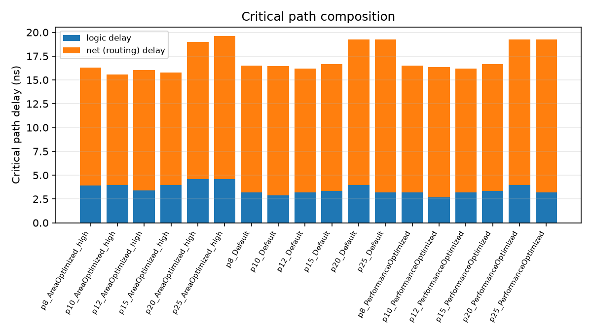
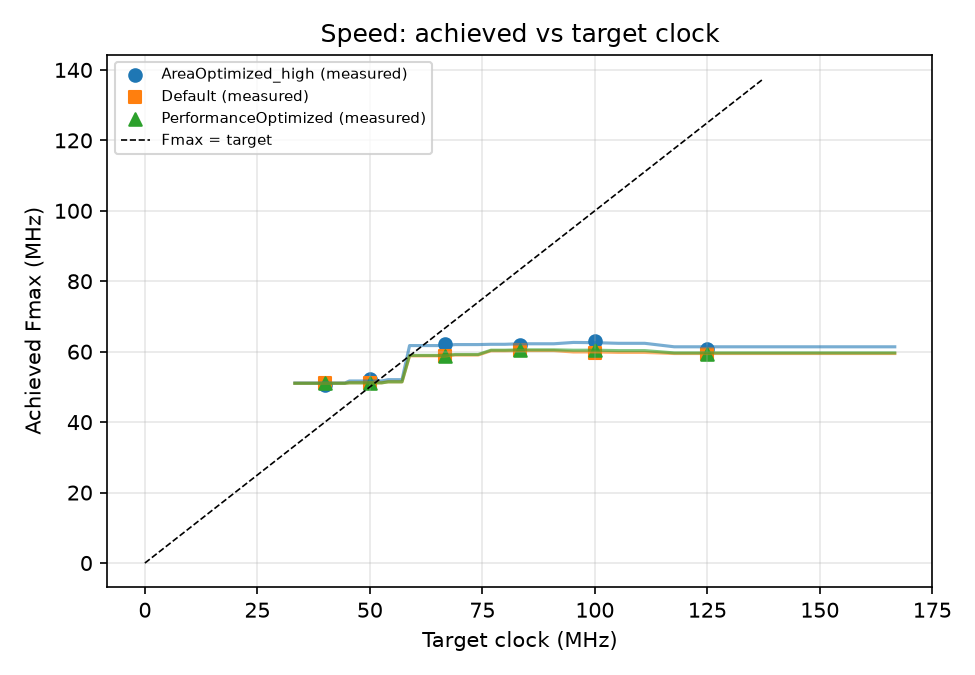
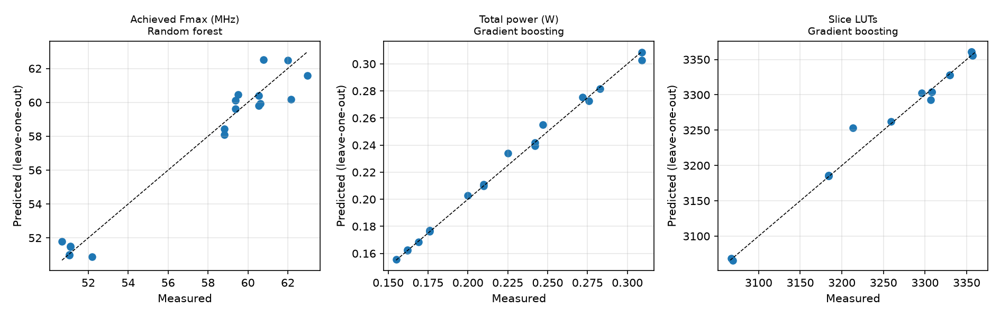
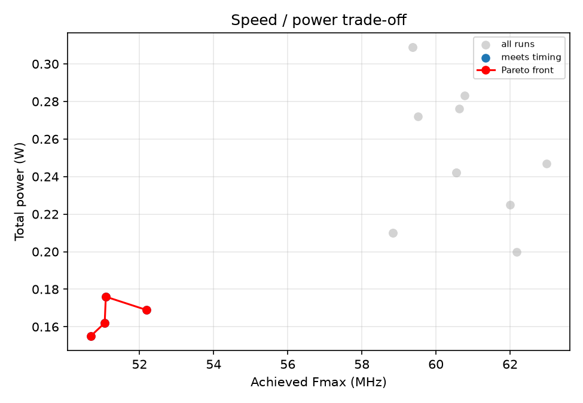
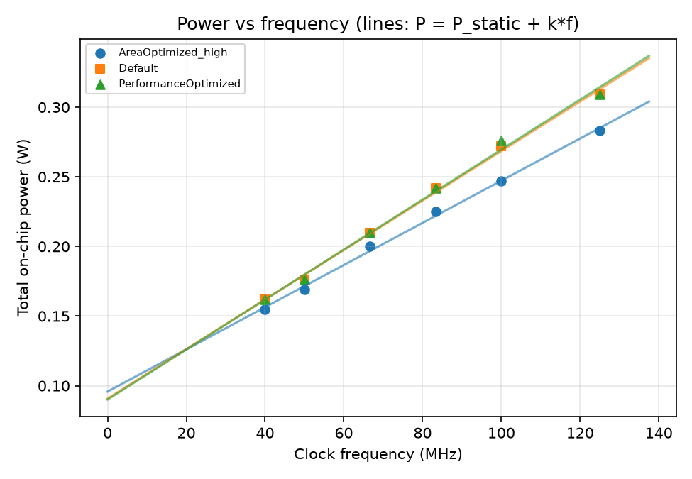

# PBL-2 Task 7: AI-based design parameter analysis

Device: xc7z020clg484-1 (ZedBoard), out-of-context implementation. 18 runs over 6 clock targets x 3 synthesis directives.

Power is Vivado's vectorless estimate (default toggle rates).

## Measured results

| run                      |   wns_ns |   fmax_mhz |   logic_levels |   luts |   lutram |   ffs |   total_power_w |   energy_per_instr_nJ |   runtime_ns |
|:-------------------------|---------:|-----------:|---------------:|-------:|---------:|------:|----------------:|----------------------:|-------------:|
| p8_Default               |   -8.844 |      59.37 |             15 |   3356 |      432 |  2048 |           0.309 |                 2.472 |          392 |
| p8_PerformanceOptimized  |   -8.844 |      59.37 |             15 |   3356 |      432 |  2048 |           0.309 |                 2.472 |          392 |
| p8_AreaOptimized_high    |   -8.455 |      60.77 |             18 |   3307 |      432 |  2055 |           0.283 |                 2.264 |          392 |
| p10_Default              |   -6.803 |      59.51 |             16 |   3357 |      432 |  2079 |           0.272 |                 2.72  |          490 |
| p10_PerformanceOptimized |   -6.496 |      60.62 |             15 |   3357 |      432 |  2062 |           0.276 |                 2.76  |          490 |
| p10_AreaOptimized_high   |   -5.876 |      62.99 |             17 |   3296 |      432 |  2068 |           0.247 |                 2.47  |          490 |
| p12_Default              |   -4.514 |      60.55 |             17 |   3330 |      432 |  2070 |           0.242 |                 2.904 |          588 |
| p12_PerformanceOptimized |   -4.514 |      60.55 |             17 |   3330 |      432 |  2070 |           0.242 |                 2.904 |          588 |
| p12_AreaOptimized_high   |   -4.13  |      62    |             17 |   3259 |      432 |  2048 |           0.225 |                 2.7   |          588 |
| p15_Default              |   -1.998 |      58.83 |             16 |   3308 |      432 |  2048 |           0.21  |                 3.15  |          735 |
| p15_PerformanceOptimized |   -1.998 |      58.83 |             16 |   3308 |      432 |  2048 |           0.21  |                 3.15  |          735 |
| p15_AreaOptimized_high   |   -1.084 |      62.17 |             17 |   3213 |      432 |  2048 |           0.2   |                 3     |          735 |
| p20_Default              |    0.428 |      51.09 |             17 |   3184 |      432 |  2048 |           0.176 |                 3.52  |          980 |
| p20_PerformanceOptimized |    0.428 |      51.09 |             17 |   3184 |      432 |  2048 |           0.176 |                 3.52  |          980 |
| p20_AreaOptimized_high   |    0.836 |      52.18 |             17 |   3067 |      432 |  2048 |           0.169 |                 3.38  |          980 |
| p25_Default              |    5.417 |      51.06 |             16 |   3184 |      432 |  2048 |           0.162 |                 4.05  |         1225 |
| p25_PerformanceOptimized |    5.417 |      51.06 |             16 |   3184 |      432 |  2048 |           0.162 |                 4.05  |         1225 |
| p25_AreaOptimized_high   |    5.268 |      50.68 |             18 |   3069 |      432 |  2048 |           0.155 |                 3.875 |         1225 |

## Model selection (leave-one-out cross-validation)

**Achieved Fmax (MHz)** - selected: Random forest

| Model | MAE | MAPE % |
|---|---|---|
| Ridge (poly-2) | 3.615 | 6.33 |
| Random forest | 0.7596 | 1.30 |
| Gradient boosting | 0.7816 | 1.37 |

**Total power (W)** - selected: Gradient boosting

| Model | MAE | MAPE % |
|---|---|---|
| Ridge (poly-2) | 0.007667 | 3.49 |
| Random forest | 0.009914 | 4.16 |
| Gradient boosting | 0.002337 | 0.97 |

**Slice LUTs** - selected: Gradient boosting

| Model | MAE | MAPE % |
|---|---|---|
| Ridge (poly-2) | 49.1 | 1.51 |
| Random forest | 22.33 | 0.69 |
| Gradient boosting | 5.53 | 0.17 |

## Which knobs matter (permutation importance)

**Achieved Fmax (MHz)**: freq_mhz (1.88), dir_AreaOptimized_high (0.0788), dir_Default (0.00102), dir_PerformanceOptimized (0.000536)

**Total power (W)**: freq_mhz (1.86), dir_AreaOptimized_high (0.0502), dir_PerformanceOptimized (0.000183), dir_Default (3.38e-05)

**Slice LUTs**: freq_mhz (1.56), dir_AreaOptimized_high (0.42), dir_Default (0), dir_PerformanceOptimized (0)

## Physics-informed power model: P = P_static + k * f

| Directive | P_static (W) | k (mW/MHz) | R^2 |
|---|---|---|---|
| AreaOptimized_high | 0.0958 | 1.5140 | 0.9972 |
| Default | 0.0908 | 1.7767 | 0.9968 |
| PerformanceOptimized | 0.0901 | 1.7944 | 0.9945 |

A near-1 R^2 confirms dynamic power scales linearly with frequency (P_dyn = a*C*V^2*f); k captures the design's effective switched capacitance.

## Model-driven recommendations

| Directive | Fastest predicted-safe period (ns) | Freq (MHz) | Pred. power (W) | Pred. energy/instr (nJ) |
|---|---|---|---|---|
| AreaOptimized_high | 16.5 | 60.61 | 0.2 | 3.3 |
| Default | 20.0 | 50.0 | 0.1761 | 3.521 |
| PerformanceOptimized | 17.0 | 58.82 | 0.2102 | 3.573 |

These periods are interpolated by the model, including ones never run. Validate one by adding it to `periods` in sweep.tcl and comparing.

**Measured Pareto-optimal runs (speed vs power, timing met):** p20_Default, p20_AreaOptimized_high, p25_Default, p25_AreaOptimized_high

## Critical path

Logic levels: 15-18. Logic delay is 20.6% of the critical path on average; the rest is routing. In a single-cycle design the path runs PC -> imem -> regfile -> ALU -> dmem -> writeback, so pipelining is the next lever for Fmax.

## Plots

